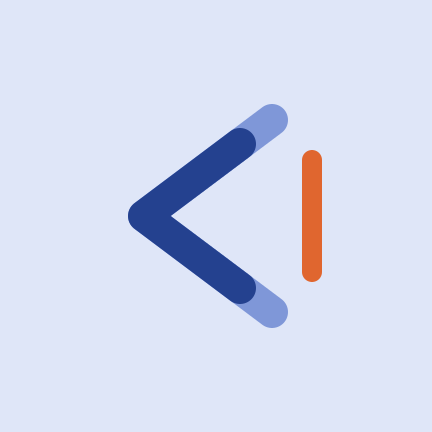

# QuireCode

A native code editor for Android tablets, with a Linux machine behind it.

QuireCode looks and works like VS Code: its keybindings, settings, themes and grammars. It's built for a tablet with a
keyboard. The editor, Explorer, terminals, notebooks and Git are in the app. Language servers, debuggers, Jupyter
kernels and your tools run in the Linux guest of Android's **Linux Terminal**, on the same tablet, through a small daemon
that the app installs there. The daemon can also run on a Linux or Windows computer on your network.

## What you need

* An Android tablet with Android 14 or later and the **Linux Terminal** app, set up with its Debian guest. Android
  offers Linux Terminal on some devices, from Developer options. QuireCode is made and tested on a Galaxy Tab S11 Ultra.
* About 1.5 GB free in the guest for the daemon and its tools (uv, ty, ruff, ripgrep, Jupyter, debugpy, TypeScript,
  Copilot). More tools can be installed later from the app.
* A hardware keyboard is recommended. The on-screen keyboard works too, with a key bar for Esc, Tab, Ctrl, Alt and the arrows.

## Install

1. Download `quirecode-<version>.apk` from the [latest release](../../releases/latest) and install it. To get updates,
   watch the releases, or add this repository to [Obtainium](https://github.com/ImranR98/Obtainium).
2. Open **Linux Terminal** once, so the guest is running.
3. Open QuireCode. In **Connect**, choose **Set up or pair…**:
   1. **Copy command**, then **Open Linux Terminal**, and paste the command there. It installs the daemon and its
      tools, which takes a few minutes, then prints a pairing code.
   2. If Android asks to open port 19870, accept it.
   3. Back in QuireCode, enter the pairing code and choose **Pair and connect**.

The app remembers the connection. When the guest is running, it reconnects by itself.

Want a new pairing code later, for another tablet or after reinstalling the app? Run `quirecode-daemon pair` in Linux
Terminal.

### A computer instead of the tablet's guest

The daemon also runs on a Linux computer, or on Windows through WSL2. Your files, tools and CPU are then the computer's.
The release includes the daemon for both (`quirecode-daemon-<version>-linux-x86_64` and `-linux-arm64`). See
[Hosting the daemon on a computer](docs/HOSTING-THE-DAEMON.md).

## Updating

Install the new APK over the old one. If the guest's daemon is from an older release, the app says so and offers
**Update**. That runs the same setup again and keeps the pairing.

## When the guest goes away

* **Android may stop the guest** when the tablet runs low on memory, or when apps start many background processes.
  Android limits them to 32 for the whole device, and the guest uses several. QuireCode says when this happens; open
  Linux Terminal to start the guest again, and the app reconnects.
* **Offline:** while the guest is away, the files of your last folder open from the copies kept on this device. Saves
  wait and go to the guest when it's back.
* **Port 19870 isn't reachable after the guest starts:** close Linux Terminal fully, from Recents, and open it again.

## Reporting a problem

Use **Settings > About > Copy diagnostics**, or **Help: Copy Diagnostics** in the command palette. Either copies a
plain-text report to the clipboard: versions, device, the guest's state and the app's recent messages. Read it, then
paste it into a [new issue](../../issues/new) with what you did and what happened.

## Privacy

QuireCode has no telemetry and no accounts of its own. It talks to the daemon you pair it with. GitHub Copilot and the
chat agents talk to their services only after you sign in to them. Connection tokens are kept encrypted with Android's
Keystore.

## Licence

QuireCode is licensed under the [Apache License 2.0](LICENSE). It includes open-source components under their own
licences; **Settings > About > Open-source licences** lists them. Building from source and the project's design
documents are covered in [CONTRIBUTING.md](CONTRIBUTING.md).
